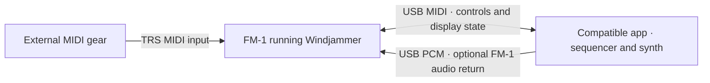

# Windjammer

Windjammer gives the M-VAVE FM-1 a native hardware interface for music apps. Play the keys, turn the encoders, record and edit patterns, or browse sounds on the FM-1 while your phone stays in your pocket. The connected app runs the sequencer and synth engines and saves your projects. Windjammer reads the controls and renders the app’s state on the FM-1’s display and LEDs.

## Play

1. Get the FM-1 controller package and checksums from [Releases](https://github.com/Osleg/Windjammer/releases). Follow the [installation guide](BUILDING.md#install) to verify and flash it.
2. Connect the powered FM-1 to Android with a USB data cable. Open a compatible version of **FM-1 Instrument** or **LOOM**, then select the FM-1’s MIDI endpoint. Android app development lives in the [LOOM repository](https://github.com/Osleg/loom-groovebox).
3. Choose where the audio plays. **FM-1 Instrument’s direct USB mode** sends the synth to the FM-1 and uses its MASTER knob. The app can also play through the phone. Other integrations advertise the audio routes they support.

The FM-1 waits for a compatible app when it starts up. Hold HOME to open device settings while disconnected. After connecting, supported workflows include sound selection, note and drum editing, modulation, effects, and project save and reload. The app determines which features its engines and project model expose.

## Firmware and protocol

Windjammer is derived from [Skiff](https://github.com/illuminus5/skiff) and keeps its page layouts, performance gestures, and all 12 function buttons. It draws native controls from app-supplied labels, values, graphs, and edit targets. Each app owns its sound engines, patterns, and project format. **FM-1 Instrument** carries the Skiff 2.5.1 musical runtime and additional engines. **LOOM** uses its own runtime.

The [open companion protocol](docs/OPEN_PROTOCOL.md) uses negotiated wire-6 USB MIDI SysEx. The first update transfers a complete view. Compatible apps can then send field changes, with a full view used to recover synchronization. The controller reports the context actually shown on the display so an old input packet cannot edit a new target. MIDI notes and clock from the FM-1’s TRS input can be forwarded to the app if it negotiates panel MIDI.

- [Native screen encoding and field bindings](docs/native-ui-wire.md)
- [Screen coverage and ownership](docs/native-ui-coverage.md)
- [High-level design](docs/HLD.md)
- [Build, install and recovery](BUILDING.md)

## Build and release

GitHub Actions builds the controller profile and checks the image, audio, native UI, protocol, and USB behavior. Successful tag builds publish a firmware prerelease with checksums, license notices, and the corresponding source revision. See the [firmware workflow](.github/workflows/firmware.yml) and [local build guide](BUILDING.md).

## License and credits

Windjammer is GPL-3.0-only. It builds on Skiff by illuminus5 and Felucca by Leo Kuroshita and Hügelton Instruments. The [license](LICENSE) and [third-party notices](LICENSING.md) travel with the firmware. M-VAVE and FM-1 identify the target hardware.
